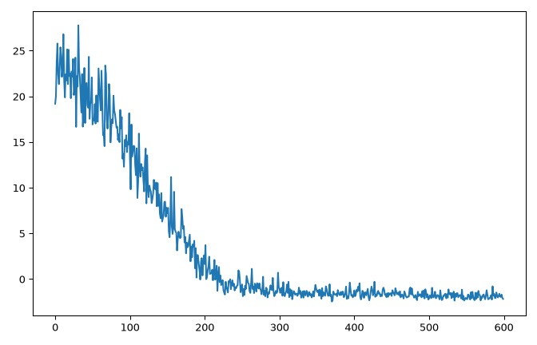
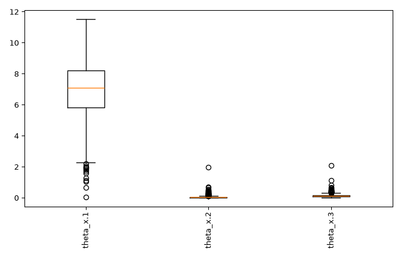
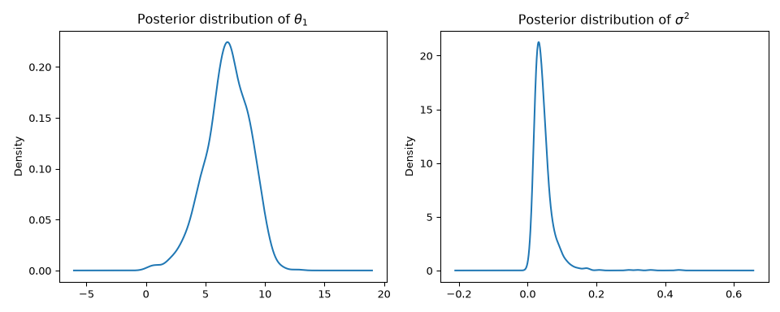
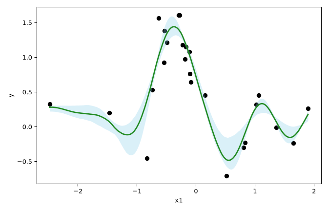
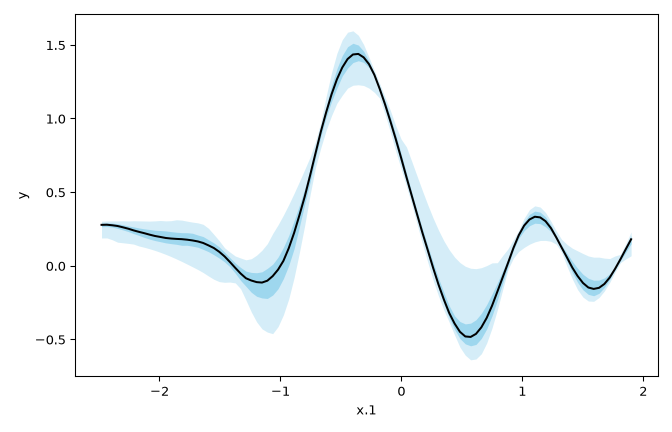
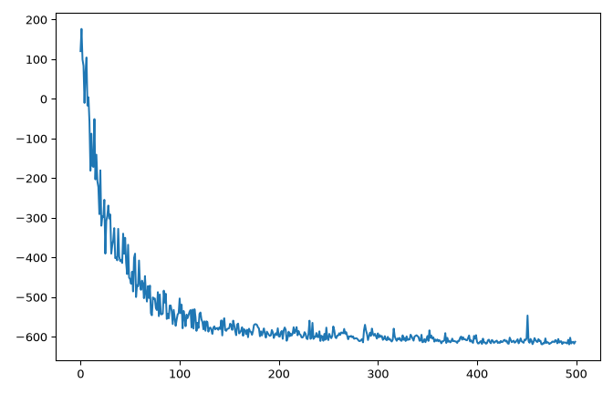
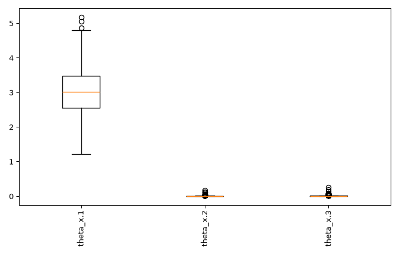
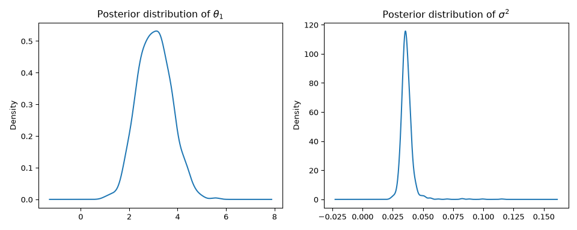
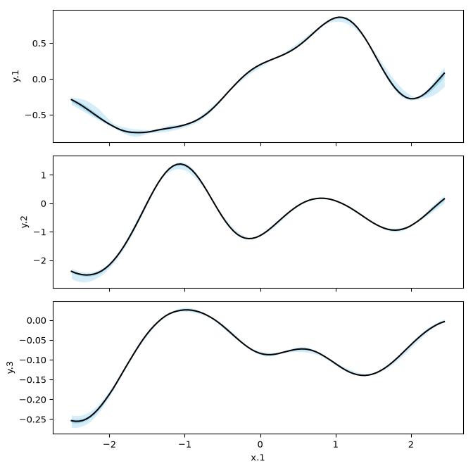

# shrinkgpr: Normalizing Flows for Hierarchical Shrinkage in Gaussian Process Regression Models

This repository contains the Python port of the R package
[shrinkGPR](https://github.com/NeferkareII/shrinkGPR) for Gaussian process
regression with hierarchical shrinkage priors. `shrinkgpr` uses PyTorch to
estimate the parameters via variational inference, with the posterior
approximated by normalizing flows. It is designed with GPU acceleration via
CUDA in mind and, while it works with the CPU version of PyTorch, it may be
slow that way, especially for larger models.

The examples below simulate data, fit uni- and multivariate models with
shrinkage priors on the kernel parameters, check convergence, draw posterior
samples and make predictions. They are not exhaustive; every class and method
has a docstring with the full set of options.

## Prerequisites

`shrinkgpr` needs Python 3.10 or newer. Install a PyTorch build that matches
your hardware first (see the [PyTorch installation
guide](https://pytorch.org/get-started/locally/); a CUDA build is recommended),
then the package:

```bash
pip install git+https://github.com/NeferkareII/shrinkGPR_py
```

```python
import torch

# If this returns False, the package works, albeit slower
torch.cuda.is_available()
```

    True

The examples use these imports:

```python
import matplotlib.pyplot as plt
import numpy as np
import pandas as pd
import torch

from shrinkgpr import ShrinkGPR, ShrinkMVGPR, ShrinkMVTPR, ShrinkTPR, sim_gpr, sim_mvgpr
```

## Usage

### Univariate Response Models

#### Simulate Data

The `sim_gpr` function simulates data from a Gaussian process regression model:

```python
torch.manual_seed(117)
sim = sim_gpr(N=25, theta=[10, 0, 0], d_mean=0, sigma2=0.1)
```

`sim["data"]` is a DataFrame with the response `y` and the covariates `x.1`,
`x.2` and `x.3`. Only the first covariate truly has an impact on `y`; the other
two are noise.

#### Model Fitting

A model is constructed first and then trained with `fit`. Here the model is
built from a formula, in the style of R; it can also be built directly from
arrays or DataFrames, as in `ShrinkGPR(y, x)`:

```python
model = ShrinkGPR.from_formula("y ~ .", data=sim["data"]).fit(display_progress=False)
```

`display_progress=False` turns off the progress bar. Calling `fit` again
continues training where it stopped.

Alternatively, a t-process can be fitted with `ShrinkTPR`:

```python
model_t = ShrinkTPR.from_formula("y ~ .", data=sim["data"]).fit(display_progress=False)
```

#### Check Convergence

Plot the model's loss to monitor convergence:

```python
plt.plot(model.loss_stor_)
```



#### Checking on Inverse Lengthscale Parameters

A quick check of covariate relevance can be performed by plotting the inverse
lengthscale parameters $\theta_1, \dots, \theta_d$. This is what the `plot`
method does:

```python
model.plot()
```



#### Generate Posterior Samples

More samples from the variational approximation can be generated with
`gen_posterior_samples`:

```python
samples = model.gen_posterior_samples(nsamp=1000)
```

For example, this allows a more detailed look at the posterior distributions of
the inverse lengthscale parameters and the noise variance:

```python
fig, axes = plt.subplots(1, 2)
samples["thetas"]["theta_x.1"].plot.kde(ax=axes[0], title=r"Posterior distribution of $\theta_1$")
pd.Series(samples["sigma2"]).plot.kde(ax=axes[1], title=r"Posterior distribution of $\sigma^2$")
```



#### Predictions

`calc_pred_moments` calculates the predictive means and variances at new data
points. Here, we predict across a range of values of the first covariate while
holding the other two at zero:

```python
x1 = sim["data"]["x.1"]
newdata = pd.DataFrame({"x.1": np.linspace(x1.min(), x1.max(), 200), "x.2": 0.0, "x.3": 0.0})
preds = model.calc_pred_moments(newdata, nsamp=1000)
```

Alternatively, `predict` samples directly from the full posterior predictive
distribution:

```python
preds_samples = model.predict(newdata, nsamp=1000)
```

Plot the predicted values and 90% credible intervals:

```python
q05, q50, q95 = np.quantile(preds["means"], [0.05, 0.5, 0.95], axis=0)

plt.scatter(x1, sim["data"]["y"], color="black")
plt.plot(newdata["x.1"], q50, color="forestgreen", linewidth=2)
plt.fill_between(newdata["x.1"], q05, q95, color="skyblue", alpha=0.3, linewidth=0)
plt.xlabel("x1")
plt.ylabel("y")
```



#### Sweep Over One Covariate

`gen_marginal_samples` generates samples from the marginal posterior predictive
distribution over a grid of one (or two) covariates, while either fixing the
other covariates or sampling them from the training data. Here, we sweep over
the first covariate while holding the other two at zero:

```python
marginal_samples = model.gen_marginal_samples("x.1", fixed_x={"x.2": 0, "x.3": 0})
```

The result has a `plot` method, which visualizes the marginal effect of the
first covariate with its 50% and 95% credible bands:

```python
marginal_samples.plot()
```



### Multivariate Response Models

#### Simulate Data

`sim_mvgpr` simulates from a multivariate GPR model:

```python
torch.manual_seed(42)
sim_mv = sim_mvgpr(N=200, M=3, d=3, theta=[3, 0, 0], sigma2=0.1)
```

#### Model Fitting

A multivariate GPR model is fitted with `ShrinkMVGPR`. The responses are given
with `cbind` in the formula, as in R:

```python
model_mv = ShrinkMVGPR.from_formula("cbind(y.1, y.2, y.3) ~ .", data=sim_mv["data"]).fit(
    display_progress=False, optim_control={"lr": 1e-3})
```

A small note here: the default learning rate of the multivariate models is set
fairly conservatively at `1e-4`, to ensure convergence across a wide array of
model sizes. For smaller models this may be unnecessarily slow, and a learning
rate of `1e-3` or even `1e-2` may be appropriate. If you find convergence to be
slow, try playing with the learning rate.

Analogous to the univariate case, a multivariate t-process is fitted with
`ShrinkMVTPR`:

```python
model_mv_t = ShrinkMVTPR.from_formula("cbind(y.1, y.2, y.3) ~ .", data=sim_mv["data"]).fit(
    display_progress=False)
```

#### Check Convergence

Checking convergence works the same way in the multivariate case:

```python
plt.plot(model_mv.loss_stor_)
```



#### Checking the Model and Generating Posterior Samples

The methods for generating and visualizing samples from the variational
approximation of the posterior are the same as in the univariate case:

```python
model_mv.plot()
```



```python
samples_mv = model_mv.gen_posterior_samples(nsamp=1000)

fig, axes = plt.subplots(1, 2)
samples_mv["thetas"]["theta_x.1"].plot.kde(ax=axes[0],
                                           title=r"Posterior distribution of $\theta_1$")
pd.Series(samples_mv["sigma2"]).plot.kde(ax=axes[1], title=r"Posterior distribution of $\sigma^2$")
```



#### Predictions

Marginal effects are visualized with `gen_marginal_samples`, just like in the
univariate case. Here, we show the marginal effect of the first covariate on
each response, while holding the other two covariates at zero:

```python
marg = model_mv.gen_marginal_samples("x.1", fixed_x={"x.2": 0, "x.3": 0})
marg.plot()
```



### Saving and Loading

A fitted model, including its optimizer state, can be saved and loaded again,
for example to continue training later:

```python
import shrinkgpr

model.save("model.pt")
model = shrinkgpr.load("model.pt")
```

Only load files you trust: the file is unpickled, which can run arbitrary code.

## Differences from the R package

The numerics follow the R package, and `compare/` checks the port against it
function by function. The interface follows Python conventions: models are
constructed and then trained with `fit`, the fitted state lives in attributes
such as `loss_stor_`, and prediction and posterior functions are methods.
Plots use matplotlib, and saved models are not interchangeable between R and
Python. `CLAUDE.md` lists all deliberate deviations.
